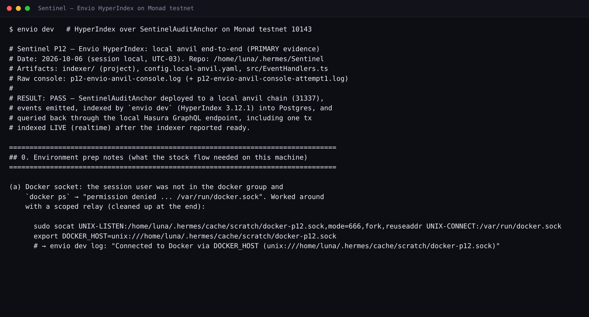

# The audit trail you can query

Sentinel anchors a hash-chained decision journal to `SentinelAuditAnchor` on Monad. Anchoring proves the journal existed at a point in time. It does not, on its own, make the journal readable. A contract emits an event per batch, and events are cheap to write and awkward to read: to rebuild history from a node you have to know which block ranges to ask for, and you have to ask again for every page. That gap is what the Envio indexer closes.

## The flow, end to end

**1. The contract event.** Our anchor contract emits two events, declared at `indexer/config.yaml:45-46`: `DecisionAnchored(uint64 seq, bytes32 entryHash, bytes32 runningRoot, address account)` and `Heartbeat(address guardian, bytes32 riskStateHash, uint32 openPositions, uint8 maxTier)`. Both come from our own ABI, not from an exchange we do not control.

**2. HyperSync.** The chain block at `indexer/config.yaml:29-33` sets `id: 10143` with `start_block: ${ENVIO_START_BLOCK:-0}` (`config.yaml:31`) and an `rpc:` list (`config.yaml:32-33`). The header comment at `config.yaml:3-5` records the ordering: HyperSync (`https://monad-testnet.hypersync.xyz`) is the default data source and the RPC below it is the fallback and realtime source. A start block of 0 tells HyperSync to find the first block that holds a matching event, so an operator does not have to know the deploy block ahead of time.

**3. Handler to entity.** `indexer/src/EventHandlers.ts:31-41` writes one `SentinelAnchor` row per anchored batch: `seq`, `entry_hash`, `root`, `account`, block timestamp, transaction hash. The row id is `${chainId}_${block.number}_${logIndex}` (`EventHandlers.ts:34`). The heartbeat handler at `EventHandlers.ts:52-59` writes `SentinelHeartbeat`. The entities themselves are frozen in `indexer/schema.graphql`: `SentinelAnchor` at `schema.graphql:44-52`, `SentinelHeartbeat` at `schema.graphql:54-61`, and `Liquidation` at `schema.graphql:22-34`.

**4. GraphQL.** Envio persists those rows and exposes them over GraphQL. Note the scalar mapping, called out at `schema.graphql:2-6`: `BigInt` columns are serialized as JSON strings, never floats.

**5. The Rust client.** `crates/sentinel/src/indexer.rs` is the read side. `anchors_after(from_seq)` posts the query at `indexer.rs:27`, `SentinelAnchor(where:{seq:{_gte:$from}}, order_by:{seq:asc})`; `heartbeats(limit)` posts the one at `indexer.rs:30`; `recent_liquidations` uses `indexer.rs:33` and `:36`. `from_env()` at `indexer.rs:102-108` returns `None` when `ENVIO_GRAPHQL_ENDPOINT` is unset, so the feature degrades off instead of breaking the reflex path. Every integer decodes from either a JSON number or a numeric string (`indexer.rs:349-369`), because Envio string-serializes `BigInt`. Failures are wrapped with a bounded excerpt of 200 characters (`indexer.rs:24`, `:379-387`), so a noisy upstream body cannot flood the logs.

**6. The dashboard.** The dashboard's audit panel reads anchor rows, and the resilience panel reads heartbeat rows. The intended path is recorded in `docs/architecture.md:85-86`: the indexer mirrors anchors back for dashboards and backtests. Today the single-file dashboard reads the daemon's local API state (`dashboard/index.html:472-477`), and the Rust client is the frozen, tested interface that points the same GraphQL surface at the hosted indexer once one exists.

## Why Envio is load-bearing here

An audit trail is a claim about the past, so whatever renders it has to be able to read the past. That is the hard part.

An RPC `eth_getLogs` call is scoped to a block range. To show the full trail over plain RPC you walk ranges from the beginning, page through the results, and keep your own state between requests, all against a rate-limited public endpoint. The dashboard would, in practice, only see the last block. The proof that matters to a user is not "the newest anchor exists"; it is "here is every anchor, in order, since sequence N". Without indexed history you cannot answer that question, you can only answer a much smaller one.

HyperSync serves the indexed history in one request, and Envio keeps it queryable. That turns the real question, "every anchor with `seq >= N`, ascending", into one line, which is literally the query in `indexer.rs:27`. The `seq >= from` filter with ascending order is the anchor of the whole design: it lets the audit-verify cross-check ask for exactly the tail it has not seen yet, and it lets the dashboard scroll the whole trail without re-deriving it.

## Configuration

| Variable | Default | What it does |
|---|---|---|
| `ENVIO_START_BLOCK` | `0` | Chain start block (`indexer/config.yaml:31`). `0` makes HyperSync auto-detect the first block with a matching event, so no deploy block has to be known in advance. The per-contract override is `ENVIO_ANCHOR_START_BLOCK` (`config.yaml:42`). |
| `ENVIO_RPC_URL` | `https://testnet-rpc.monad.xyz` | Monad testnet RPC (`indexer/config.yaml:33`), used as the fallback and realtime source under HyperSync. |
| `ENVIO_ANCHOR_CONTRACT_ADDRESS` | zero address | The deployed `SentinelAuditAnchor` address (`indexer/config.yaml:41`). Placeholder until the live deploy lands. |
| `ENVIO_GRAPHQL_ENDPOINT` | unset | Read by the Rust client (`indexer.rs:102-108`). Unset means the feature is off, not broken. |

## What actually ran

The standing proof is a local anvil run on chain 31337, using `config.local-anvil.yaml` (noted at `indexer/config.yaml:6`). `docs/evidence/p12-envio-anvil.txt:56-84` shows the deploy and three transactions. The indexer, Envio 3.12.1 (`p12-envio-anvil.txt:8`), reported "The indexer storage is ready. Starting indexing!" and then "The indexer is ready. Switching to realtime indexing." (`docs/evidence/p12-envio-anvil-console.log:13,42`). It created 12 schema indexes, among them `SentinelAnchor_seq_2g4ufelrzx` and `SentinelHeartbeat_ts_bbv93d7orj` (`p12-envio-anvil-console.log:33-36`).

Then the interesting part: an anchor sent after the indexer went ready was picked up live. The console records `source: "RPC (127.0.0.1:8547)"`, `knownHeight: 4`, `newBlockHeight: 5` (`p12-envio-anvil-console.log:48-52`), and the `seq=3` row came back over GraphQL with tx `0xeea21503885fee68b9ae65f0c563f15a654c5e8e8ead47088693f25d02bd1cf6` (`p12-envio-anvil.txt:149-155`). A Postgres cross-check matched the API: 3 anchors, 1 heartbeat, 0 fills, 0 liquidations (`p12-envio-anvil.txt:169-171`).

## Honest status

The hosted Envio Cloud deploy is not live. `pnpx envio@latest deploy` returned "error: unrecognized subcommand 'deploy'" and the cloud CLI reported "You are not currently logged in" (`docs/evidence/p12-envio-cloud.txt:11,26`), so nothing was deployed and `ENVIO_GRAPHQL_ENDPOINT` was deliberately left unset (`p12-envio-cloud.txt:53`). On Monad testnet the anchor contract itself is not deployed yet either (STUB-17); `indexer/config.yaml:36-39` keeps a zero-address placeholder until it is. What runs today is the local anvil proof above, over RPC. The HyperSync path is what `config.yaml` declares for chain 10143, and it is the path the deployed config will use.

The Perpl exchange events (`PerpFill`, `Liquidation`, `AccountSnapshotDay`) are declared but not handled: the exchange ABI was unresolved within the time budget (`indexer/README.md:103-117`), so those tables exist and return empty. The liquidation read path in the Rust client (`indexer.rs:33`, `:36`) is already wired and tested, waiting on the handler.

## Testing the read path

`crates/sentinel/tests/p12_adversarial.rs` treats the client as a black box and pins its behavior. The anchors query must name `SentinelAnchor` and no other entity (`p12_adversarial.rs:199-219`); the sequence bound must travel as a `BigInt` string (`:220-233`); `BigInt` must decode identically from a string and a number (`:387-458`); a non-empty `errors` array must fail loudly and mention graphql (`:532-577`); and an empty `data` object must be a deterministic error, never a silent empty page (`:579-621`). The suite also cross-checks the artifacts on disk: `schema.graphql` has to declare exactly five entities with the frozen snake_case field names (`:812-887`), and `config.yaml` has to reference chain 10143 (`:915-953`).

---

## Bounty answer (paste into the form)

Sentinel is a non-custodial risk guardian for isolated-margin perpetual futures on Perpl (Monad). Its audit spine is an append-only hash-chained journal; batches of entries are anchored on-chain to our own `SentinelAuditAnchor` contract, which emits `DecisionAnchored(seq, entryHash, runningRoot, account)` and `Heartbeat(guardian, riskStateHash, openPositions, maxTier)`.

We index those two events with Envio HyperIndex 3.12.1. `indexer/src/EventHandlers.ts` maps `DecisionAnchored` into `SentinelAnchor` rows and `Heartbeat` into `SentinelHeartbeat` rows (`indexer/src/EventHandlers.ts:24-60`), with the entities and indexes declared in `indexer/schema.graphql`. On Monad testnet (chain 10143) the config is HyperSync-first: `indexer/config.yaml:3-5` records HyperSync (`https://monad-testnet.hypersync.xyz`) as the default data source with the Monad RPC as the fallback/realtime source, and `start_block: 0` (`config.yaml:31`) lets HyperSync auto-detect the first block containing a matching event.

Why that matters, concretely. An audit trail is a claim about the past. An RPC `eth_getLogs` call is scoped to a block range, so a naive reader ends up walking ranges from the start, paging, and holding its own state against a rate-limited public endpoint. HyperSync serves the indexed history directly, so a reader can ask the real question, "every anchor with `seq >= N`, ascending", and get the whole trail. The Rust client that consumes it (`crates/sentinel/src/indexer.rs:27`) is exactly that query, plus latest heartbeats and recent liquidations.

The read path is a first-class part of the product, not a side script. `crates/sentinel/src/indexer.rs` is a frozen GraphQL client with a 15-second request timeout (`indexer.rs:20-21`) that decodes Envio's string-serialized `BigInt` tolerantly (`indexer.rs:349-369`), degrades off cleanly when `ENVIO_GRAPHQL_ENDPOINT` is unset (`indexer.rs:102-108`), and bounds every error excerpt to 200 characters (`indexer.rs:24`). It is pinned by an independent adversarial suite (`crates/sentinel/tests/p12_adversarial.rs`): exact entity and field names, `BigInt` in both string and number form, non-empty GraphQL errors failing loudly, and the schema and config artifacts cross-checked on disk.

Status, stated honestly. What is proven today is the local end-to-end run. On a local anvil chain (31337) we deployed `SentinelAuditAnchor`, ran `pnpx envio@latest dev` (Envio 3.12.1), and watched it go from "The indexer is ready. Switching to realtime indexing." to indexing a live anchor transaction six seconds later: `seq=3`, tx `0xeea21503885fee68b9ae65f0c563f15a654c5e8e8ead47088693f25d02bd1cf6`, `source: "RPC (127.0.0.1:8547)"`, block 4 to 5. Rows for seq 1 through 3 queried back through GraphQL, with a Postgres cross-check matching (3 anchors, 1 heartbeat). The full transcript is `docs/evidence/p12-envio-anvil.txt` and `docs/evidence/p12-envio-anvil-console.log`.

Not yet live: the hosted Envio Cloud deployment (no account was available in the build environment, so no successful deploy was attempted), and live Monad-testnet rows (the anchor contract itself deploys when the funded wallet lands, STUB-17). The exchange-event entities (`PerpFill`, `Liquidation`, `AccountSnapshotDay`) exist with a live GraphQL surface but stay empty until the Perpl exchange ABI is resolved; the `Liquidation` read path in the Rust client is already wired and tested against it.

Evidence: `docs/evidence/p12-envio-anvil.txt`; `docs/evidence/p12-envio-anvil-console.log`; `docs/evidence/p12-envio-cloud.txt`; `indexer/src/EventHandlers.ts`; `indexer/schema.graphql`; `indexer/config.yaml`; `crates/sentinel/src/indexer.rs`; `crates/sentinel/tests/p12_adversarial.rs`; `docs/queries.graphql`
