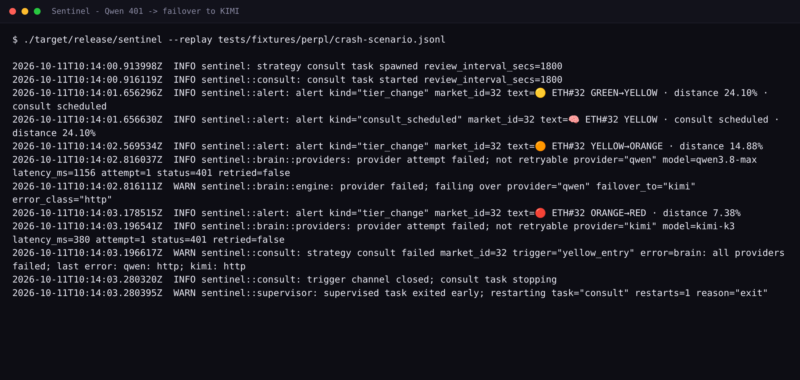

# KIMI in Sentinel: the fallback brain that keeps the guardian thinking



Sentinel is a non-custodial risk guardian for isolated-margin perpetual futures on [Perpl](https://app.perpl.xyz) (Monad). It runs two language models on its strategy path: Alibaba's Qwen as primary and Moonshot's KIMI (`kimi-k3`) as the fallback. The reflex engine, the policy gate, and the audit journal are deterministic and vendor-free. Only the judgement layer sits behind a model, and that layer has a second provider so a single vendor outage does not leave the guardian blind.

## Why a second provider

A model vendor fails in several ways that matter to a system watching money: 5xx bursts, a 200 response with a changed or malformed body, a 401 when a key rotates, a 429 under load. Retry-with-backoff covers a fraction of that and none of the semantic failures. A guardian that can only think with one vendor is a single point of failure on the one path where judgement is the whole product.

Sentinel's answer is two independent providers behind one contract, each with its own health state, and a recorded fact about which one actually answered.

## The chain, in code

One engine runs regardless of provider. `StrategyEngine::consult` (`crates/sentinel/src/brain/engine.rs:210`) enforces the per-market rate limit, then the hourly and daily budget guard (`engine.rs:215`), then attempts the primary (`engine.rs:248`). If the primary fails and a fallback is configured, the engine logs the failover and retries the identical prompt on the fallback slot (`engine.rs:277`). Both providers implement one trait, `Provider::complete` (`brain/providers.rs:59`), and KIMI's implementation (`brain/providers.rs:192`) posts the same OpenAI-compatible chat-completions body. The daemon wires the pair once with `.with_fallback(KimiProvider::new(&cfg.kimi))` (`crates/sentinel/src/main.rs:717`).

Because KIMI speaks the same shape, everything downstream is reused with no second code path: the versioned system prompt, the tolerant parser (strip thinking, extract the first balanced object, validate), the single repair nudge, the grounding check, and the confidence floor.

One difference is deliberate. KIMI is never sent `response_format: json_object` (`brain/providers.rs:174`, pinned by the wiremock test `kimi_success_omits_response_format` at `brain/providers.rs:687`). The fallback cannot assume a json-mode flag exists, so it runs through the same tolerant parser that already handles Qwen's thinking trace. Robustness is the default here, not a fallback-only special case.

## Why KIMI is the right choice

**Schema compliance and structured output.** Every consult must parse into a typed `Decision` carrying `action`, `market_id`, `amount`, `confidence`, `urgency`, and `reason`, and it must pass validation against the allowed markets and the action set (for example, a REDUCE requires a positive amount). The engine does not take that on faith. The parser validates the object, and a failure gets exactly one repair nudge before failing closed (`engine.rs:486`). A model that emits well-formed objects on the first try spends fewer of those repair calls.

**Code-tuned model.** `kimi-k3` is trained heavily on code and structured text, which is precisely the shape the prompt asks for: one JSON object and no narration. That alignment lowers first-pass parse failures without loosening the contract, because the contract (parse, validate, ground, floor) is identical for both slots.

**Independent circuit breaker.** Each slot gets its own `CircuitBreaker` (`brain/chain.rs:32`), built as a pair by `breaker_pair` (`chain.rs:116`) and held as `[primary, fallback]` (`engine.rs:102`). Three consecutive failures open a slot for five minutes (`engine.rs:39`), after which a half-open probe tests recovery (`chain.rs:57`, `chain.rs:85`). When the primary's breaker is open, the consult goes straight to the fallback without paying the primary's timeout first (`engine.rs:465`). KIMI's breaker is its own, so a KIMI outage cannot drag the primary down and a primary outage cannot exhaust KIMI.

**Fail-closed, not fail-silent.** If both slots fail, the engine returns `AllProvidersFailed` naming both failure classes (`engine.rs:313`), the consult task journals the error outcome (`consult.rs:285`), and the decision is `ESCALATE`. The policy gate then blocks the order. Nothing is quietly substituted.

## Failover, proved

Two pieces of real evidence. First, the daemon replays a crash fixture, and the log shows the primary fail, the failover fire, and the chain refuse to invent an answer:

```
provider attempt failed; not retryable provider="qwen" status=401 retried=false
provider failed; failing over provider="qwen" failover_to="kimi" error_class="http"
```

Reproduce with `./target/release/sentinel --replay tests/fixtures/perpl/crash-scenario.jsonl`. In that environment both keys are placeholders, so KIMI also returns 401 and the consult fails closed to `all providers failed; last error: qwen: http; kimi: http`. That is the correct outcome: no provider, no guess, no order.

Second, the offline brain eval proves KIMI itself can carry the workload. With the primary force-failed (`FORCE_PROVIDER_FAIL=qwen`), the full scoreboard passes 14/14 with `provider=kimi` on every row, including both prompt-injection rows (`docs/evidence/p08-failover.txt`). The safety properties of the brain, schema validity and grounding, belong to the engine rather than to one vendor.

## Configuring KIMI

KIMI is configured with three environment variables, read once at load (`config.rs:362`):

| Variable | Purpose | Default |
|---|---|---|
| `KIMI_API_KEY` | Bearer token for `api.moonshot.ai` | required, must be non-placeholder |
| `KIMI_BASE_URL` | OpenAI-compatible base; requests go to `{base}/chat/completions` | `https://api.moonshot.ai/v1` |
| `KIMI_MODEL` | Model id | `kimi-k3` |

`KIMI_API_KEY` is wrapped in `SecretString` (`config.rs:27`), whose `Debug` prints `SecretString(REDACTED)`, so the key cannot leak through a log line even if a struct is formatted. The strategy engine is built only when a real provider key is present, which keeps the pre-strategy paths unchanged when it is not (`main.rs:699`).

## Honest status

The failover machinery is implemented, tested, and reproducible offline. The keyed live call against Moonshot is operator-supplied through the environment and never committed to the repository, and every number above reproduces from the source tree with no credentials and no network.

---

## Bounty answer (paste into the form)

Sentinel is a non-custodial risk guardian for isolated-margin perpetuals on Perpl (Monad), and KIMI is the fallback brain in its strategy path. Qwen is primary; KIMI (kimi-k3) picks up every consult when the primary fails. This is not a passive backup. KIMI is a first-class slot in a provider chain with its own circuit breaker, its own health state, and a recorded answer written into the hash-chained audit journal.

How it works. At a risk transition (a position entering Yellow or Orange, after a reflex reduce, or on a periodic review), the strategy engine assembles a prompt from the live account snapshot, the policy envelope, recent reflex actions, and a Nansen smart-money block. It tries the primary. If the primary is rate-limited, returns a 5xx, 401s, times out, or emits output that fails schema validation, the engine logs the failover and retries the identical prompt on KIMI (`brain/engine.rs:277`). Any valid KIMI decision then passes the same deterministic policy gate as the primary: it can only reduce, close, or add collateral, and the gate has no model in it. Every consult records `provider_used` and `failover_from` in the journal, so a failover is an auditable fact, not a log line you have to trust.

Why we chose KIMI specifically. It is code-tuned, which suits a prompt that demands one strict JSON object with no narration; it exposes an OpenAI-compatible endpoint, so it reuses the exact same request shape, tolerant parser, repair nudge, grounding check, and confidence floor as the primary with no adapter code; and it carries an independent circuit breaker (three strikes, five-minute open, half-open probe), so a KIMI outage cannot affect the primary and vice versa.

Failover is proven, not asserted. We ship a forced-failure hook, and with the primary force-failed the full offline brain_eval scoreboard passes 14/14 with provider=kimi on every row, including the two prompt-injection rows (docs/evidence/p08-failover.txt). The daemon replay of a crash fixture shows the real sequence in the log: a Qwen 401, then `provider failed; failing over provider="qwen" failover_to="kimi"`, then a fail-closed `ESCALATE` when the keys are placeholders. If both providers fail, the engine returns AllProvidersFailed naming both classes and the policy gate blocks the order. There is no silent degradation.

Configured with KIMI_API_KEY, KIMI_BASE_URL (default https://api.moonshot.ai/v1), and KIMI_MODEL (default kimi-k3). The key is wrapped in SecretString and never appears in Debug output. The key is supplied by the operator through the environment, never committed; the failover machinery itself is fully tested offline and reproducible from the repository.
