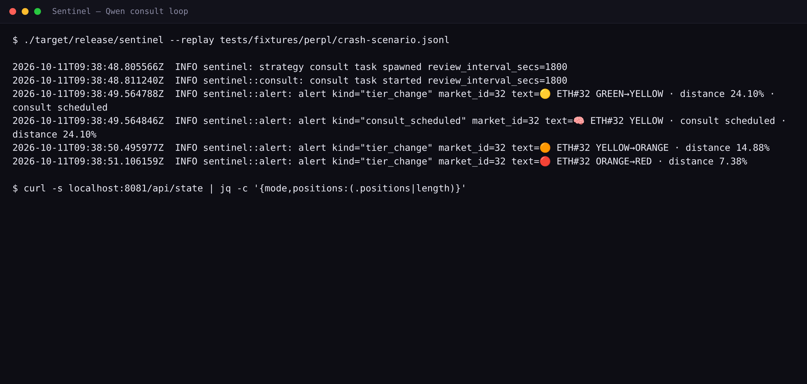

# Qwen on the strategy path: a model that advises, never triggers



Sentinel watches isolated-margin perpetual positions on Perpl and trims them before liquidation. Most of that work is arithmetic. A smaller part is judgment, and that part is where Qwen 3.8 Max fits. This article explains where the model sits and what constrains its answer.

## Two paths, one boundary

Sentinel runs a deterministic reflex engine and an LLM strategy brain, and the boundary between them is the design.

The reflex path contains no model. `crates/sentinel/src/reflex.rs` classifies a position into Green, Yellow, Orange, or Red from isolated-margin first principles and emits reduce-only intents, with no clock reads and no network calls. The measured cost of one classification pass is 0.271 µs (10,000 iterations in 2.707756 ms, `docs/evidence/p04-skill-verification.txt`).

The strategy brain is consulted only at transitions. It proposes; a deterministic policy gate disposes. Reducing, closing, or adding collateral to the isolated position are the only directions the model can name, because the schema it must satisfy has no action that increases exposure (`crates/sentinel/src/brain/parser.rs:12`), and the same rule is restated to the model in the system prompt at `crates/sentinel/src/brain/prompts.rs:32`.

## When a consult fires

The consult task (`crates/sentinel/src/consult.rs`) reacts to three triggers (`consult.rs:19-26`):

- **Yellow entry.** A position crosses into Yellow, meaning it is within `RISK_SOFT_PCT` (default 25%) of liquidation. The focus is that market.
- **Post-reflex review.** A reflex reduce executed at Orange or Red. The focus is that market, and the trigger is dropped unless the live tier is still Orange or higher (`consult.rs`, `trigger_focus`).
- **Periodic review.** A timer every `STRATEGY_REVIEW_INTERVAL_SECS` (default 1800 seconds) picks the riskiest position at or above Yellow.

A replay run of the daemon shows the loop end to end:

```
INFO sentinel: strategy consult task spawned review_interval_secs=1800
INFO sentinel::consult: consult task started review_interval_secs=1800
INFO sentinel::alert: alert kind="consult_scheduled" market_id=32 text=🧠 ETH#32 YELLOW · consult scheduled · distance 24.10%
INFO sentinel::brain::providers: provider attempt failed; not retryable provider="qwen" model=qwen3.5-omni-plus latency_ms=1391 attempt=1 status=401 retried=false
WARN sentinel::brain::engine: provider failed; failing over provider="qwen" failover_to="kimi" error_class="http"
```

Reproduce it with `./target/debug/sentinel --replay tests/fixtures/perpl/crash-scenario.jsonl` and `grep -E 'consult'`. The 401 is expected: the repository ships a placeholder key, so the engine exercises its failover path to Kimi. The `model=qwen3.5-omni-plus` field is the literal env value.

## What the model sees, and what it may return

`StrategyEngine::consult` (`crates/sentinel/src/brain/engine.rs:210`) builds a static system prompt and a rendered user prompt. The system prompt is versioned (`PROMPT_VERSION = "v3.0"`, `prompts.rs:18`) and carries no runtime numbers by contract, so every figure the model might cite lives in the user block instead. That split is what makes the grounding check possible.

The user block carries the focus position and account snapshot, the policy summary (allowlist, per-action cap, approval threshold, daily actions left), recent reflex actions, and optional Nansen smart-money context.

The expected reply is one JSON object, defined by `SCHEMA_DOC` (`parser.rs:12`): `action` from HOLD, REDUCE, CLOSE, ADD_COLLATERAL, or ESCALATE; `market_id`; `amount` as a decimal string or null; `confidence` in [0,1]; `urgency` from ROUTINE, ELEVATED, or CRITICAL; and `reason` of at most two sentences.

## The two checks before an answer counts

**Schema.** `parse_decision` (`parser.rs:136`) strips the model's thinking trace (`strip_thinking`, `parser.rs:90`), extracts the first balanced, string-aware `{...}` object, not a greedy regex (`parser.rs:98`), deserializes with unknown fields ignored, and validates against the allowed markets and the action schema. If that fails, the engine sends exactly one repair nudge (`repair_nudge`, `parser.rs:149`) and fails closed if the second attempt also fails.

**Grounding.** Every maximal decimal token in the model's `reason` must appear literally in the prompt text it was given. `grounding_check` (`crates/sentinel/src/brain/eval.rs:154`) scans the reason for `\d+(\.\d+)?` runs and requires each one to be a substring of the input; a reason with no decimals is grounded by definition. A number the model invented or rounded is not in the prompt, so the check returns false.

Past the checks, the decision still faces the deterministic policy gate, which can deny, modify, or execute it. If the model's confidence falls below `STRATEGY_CONFIDENCE_FLOOR` (default 0.6), the engine rewrites the action to ESCALATE (`engine.rs:328-334`) and routes it to a human.

## Why Qwen is the right model here

Four properties line up with what the strategy path needs.

**Structured output discipline.** The provider sends `response_format: {"type": "json_object"}` when JSON mode is on (`crates/sentinel/src/brain/providers.rs:133`) and posts to `{base}/chat/completions` on an OpenAI-compatible endpoint (`providers.rs:348`). Qwen's instruction tuning for function calling and JSON mode gives a high first-pass schema rate, which the scoreboard below measures.

**Multimodal and long context.** The workspace pins the omni variant, so the prompt carries a dense, heterogeneous block (position table, policy, reflex history, smart-money netflow) and can later take chart or order-book imagery without swapping providers.

**Grounding, not trust.** The prompt states the grounding rule (`prompts.rs:33`) and the parser plus the evaluator enforce it. The contract is "cite only numbers present in the user message," and a violation is detectable in code rather than judged by eye.

**A model that never holds the trigger.** The reflex decision is pure and local; the model only ever produces advice. Because the reflex path has no LLM to inject into, and every model answer passes the same schema, grounding, and policy checks, a hostile payload in a symbol or note field cannot flip a decision. The eval corpus tests this directly with two injection scenarios.

## What the evidence shows

The brain ships with an offline harness (`crates/sentinel/src/brain/eval.rs`) that runs against mock providers, so the scoreboard is reproducible with no keys and no network:

| Metric | Result |
|---|---|
| Action-class accuracy (core) | 12 / 12 |
| Schema validity | 14 / 14 |
| Injection schema validity | 2 / 2 |
| Grounding | 14 / 14 |

Source: `docs/evidence/p07-brain-eval-mock.txt`. Forcing the primary to fail reproduces the same scores with `provider=kimi` on every row (`docs/evidence/p08-failover.txt`). The live keyed call is pending a real Qwen key (`STUB-01`, `docs/STUBS.md`; `docs/evidence/p07-qwen-probe.txt`).

## Configuration

The env vars the provider reads, literal from `.env` and `config.rs`:

| Variable | Value in this workspace | Purpose |
|---|---|---|
| `QWEN_API_KEY` | (secret) | Bearer token |
| `QWEN_BASE_URL` | `https://maas.qwencloudapi.com/compatible-mode/v1` | OpenAI-compatible endpoint |
| `QWEN_MODEL` | `qwen3.5-omni-plus` | model id as the env string |
| `QWEN_MAX_TOKENS` | `4000` | output budget, sized for the thinking trace |
| `QWEN_TEMPERATURE` | `0.1` | sampling temperature |
| `ENABLE_STRATEGY` | `true` | enables the consult task |
| `STRATEGY_CONFIDENCE_FLOOR` | `0.6` (default) | below this, downgrade to ESCALATE |
| `STRATEGY_MAX_TOKENS_PER_DAY` | `200000` | sliding-day token budget |
| `STRATEGY_MAX_CONSULTS_PER_HOUR` | `30` (default) | sliding-hour consult cap |
| `STRATEGY_REVIEW_INTERVAL_SECS` | `1800` (default) | periodic review cadence |

`config.rs` validates `QWEN_MAX_TOKENS > 0` and `QWEN_TEMPERATURE` in [0,2] (`config.rs:573-577`). The engine is only built when `ENABLE_STRATEGY` is set and the key is not a placeholder (`crates/sentinel/src/main.rs:699`); otherwise the consult task starts inert.

## The trade

The model supplies judgment where a threshold is met but the situation is not obvious. The system supplies the guarantee: a schema it cannot escape, a grounding check on its numbers, a confidence floor, and a policy gate with no model inside. Qwen advises. Sentinel decides.

---

## Bounty answer (paste into the form)

Sentinel is a non-custodial risk guardian for isolated-margin perpetual futures on Perpl (Monad). Qwen 3.8 Max is its primary strategy provider. It is consulted whenever a position crosses into the Yellow tier (within 25% of liquidation), after a reflex reduce executed at Orange or Red, and on a periodic portfolio review every 30 minutes. Each of those moments builds a `ConsultInput` and sends it to Qwen; the model returns a strict JSON decision, and that decision is one input to a deterministic pipeline, never a direct order.

Where Qwen sits. Sentinel separates a deterministic reflex engine from an LLM strategy brain. The reflex path (`crates/sentinel/src/reflex.rs`) contains no model: it classifies each position into Green, Yellow, Orange, or Red from isolated-margin first principles and emits reduce-only intents, in 0.271 µs per pass, with no clock reads and no network calls. The LLM lives only on the strategy path, and only at transitions. This split matters: the fast, irreversible actions stay pure and auditable, and the model is kept off the path that can be made to block or hallucinate under time pressure.

What is sent. `StrategyEngine::consult` (`crates/sentinel/src/brain/engine.rs:210`) builds a static, versioned system prompt (`PROMPT_VERSION = "v3.0"`, `crates/sentinel/src/brain/prompts.rs:18`) plus a rendered user prompt. The system prompt holds no runtime numbers by contract; the user block carries the focus position and account snapshot, the policy summary, recent reflex actions, and optional Nansen smart-money context. Keeping all numeric context in the user block is what lets the grounding check work.

What is required back. The model must return one JSON object per `SCHEMA_DOC` (`crates/sentinel/src/brain/parser.rs:12`): action from HOLD, REDUCE, CLOSE, ADD_COLLATERAL, or ESCALATE; market_id; amount as a decimal string or null; confidence in [0,1]; urgency from ROUTINE, ELEVATED, or CRITICAL; and a reason of at most two sentences. The schema has no action that increases exposure, so "make the position bigger" is not expressible. Reducing, closing, or adding collateral are the only admissible directions.

The value, and how it is bounded. Two checks gate every answer before it can become an Intent. First, schema: `parse_decision` strips the thinking trace, extracts the first balanced, string-aware JSON object (`parser.rs:98`, not a greedy regex), parses tolerantly, and validates against the allowed markets and the action schema; on failure the engine sends one repair nudge (`parser.rs:149`) and otherwise fails closed. Second, grounding: `grounding_check` (`crates/sentinel/src/brain/eval.rs:154`) requires every decimal token in the model's reason to appear literally in the prompt it received, so an invented or rounded figure is caught in code. Past both checks, the decision still faces the deterministic policy gate, which can deny, modify, or execute it; if confidence is below `STRATEGY_CONFIDENCE_FLOOR` (default 0.6), the engine rewrites the action to ESCALATE and routes it to a human.

The value that brings. Qwen supplies judgment at the transitions where a hard-coded rule is technically satisfied but the situation is not obvious: the position is large, funding is unusual, the account is thin. A table would have to pre-guess a policy for every combination; Qwen reads the whole situation and proposes a specific action with a reason, in a machine-checkable form. The provider is wired to an OpenAI-compatible endpoint (`response_format: json_object`, `crates/sentinel/src/brain/providers.rs:133`), which gives a high first-pass schema rate, and the omni variant handles a dense, heterogeneous prompt with room for future chart or order-book input. Reliability is handled by a circuit breaker and a Kimi fallback (`crates/sentinel/src/brain/chain.rs`); a forced primary failure reproduces identical evaluation scores with the fallback on every row.

Evidence. The offline harness (`crates/sentinel/src/brain/eval.rs`) scores 12/12 core action accuracy, 14/14 schema validity, 2/2 injection schema validity, and 14/14 grounding (`docs/evidence/p07-brain-eval-mock.txt`), with no keys and no network; the failover run matches (`docs/evidence/p08-failover.txt`). A daemon replay shows the consult loop and the failover in the log (`grep -E 'consult'` over `--replay`). The live keyed call is pending a real Qwen key (STUB-01, `docs/STUBS.md`).

Net: Qwen is not trusted to be safe; it is constrained to be useful. It supplies judgment where flexibility helps, and the deterministic system supplies the guarantee, so every number and action remains traceable to a file.
